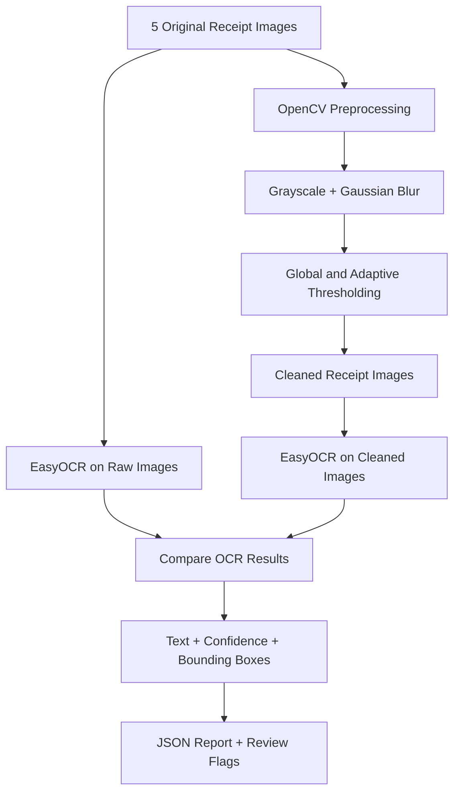

<div align="center">
  <h1>🚀 AI/ML Engineering Internship</h1>
  <p><strong>Crack404 | Weekly Projects &amp; Hands-on Learning</strong></p>
  <p>
    <a href="https://www.python.org/"></a>
    <a href="https://www.crack404.com/"></a>
    
  </p>
  <p><strong>A collection of practical AI/ML internship projects, experiments, and technical learnings.</strong></p>
  <p><em>From customer churn prediction and model persistence to computer vision and OCR.</em></p>
  <p>
    <a href="https://github.com/therash08">GitHub Profile</a> ·
    <a href="#-weekly-projects">Weekly Projects</a> ·
    <a href="#-getting-started">Getting Started</a>
  </p>
</div>

---

## 🌟 About This Repository

This repository documents the projects completed during my **AI/ML Engineering Internship at Crack404**. Each week focuses on building practical skills and turning machine learning concepts into working solutions.

The work covers the full development cycle: **data preparation → model training and evaluation → model persistence → standalone inference → image preprocessing and OCR**.

## 🛠️ Tech Stack

| Category | Technologies & Tools |
|:--|:--|
| **Programming** | Python |
| **Data Analysis** | NumPy, Pandas |
| **Visualization** | Matplotlib, Seaborn |
| **Machine Learning** | Scikit-learn |
| **Model Persistence** | Pickle, Joblib |
| **Computer Vision** | OpenCV |
| **Optical Character Recognition** | EasyOCR, PyTorch |
| **Development** | VS Code, Jupyter Notebook |
| **Version Control** | Git, GitHub |

---

## 📚 Weekly Projects

| Week | Project | Key Focus | Status |
|:--:|:--|:--|:--:|
| **01** | [Customer Churn Prediction](./week_1) | Classical ML, EDA, tuning and evaluation | ✅ Completed |
| **02** | [Model Serialization & Inference](./week_2) | Pickle, Joblib and standalone prediction | ✅ Completed |
| **03** | [Invoice & Receipt Digitization](./week_3) | OpenCV, EasyOCR and JSON extraction | ✅ Completed |

---

## 📌 Week 01 — Customer Churn Prediction

> **Module:** Data Foundations & Classical Machine Learning  
> **Dataset:** IBM Telco Customer Churn  
> **Goal:** Identify customers likely to churn, with particular attention to recall.

### What I Implemented

- Cleaned the Telco dataset, including missing `TotalCharges` values.
- Performed exploratory data analysis (EDA) and visualized churn patterns.
- Engineered additional customer-related features.
- Built preprocessing pipelines with encoding, imputation and feature scaling.
- Compared **Logistic Regression**, **Decision Tree** and **Random Forest** models.
- Tuned Random Forest using `RandomizedSearchCV` and optimized the classification threshold.
- Evaluated the final model on a held-out test set and analyzed feature importance.

### Final Test Results

| Metric | Result |
|:--|--:|
| **Accuracy** | **65.44%** |
| **Precision** | **42.86%** |
| **Recall** | **90.64%** |
| **F1-score** | **58.20%** |
| **ROC-AUC** | **0.8404** |
| **Classification threshold** | **0.36** |

**Key takeaway:** The tuned Random Forest achieved high churn recall, but at the cost of lower precision and more false-positive alerts. This trade-off matters when deciding how many customers to contact for retention.

📁 **[Explore Week 1](./week_1)**

---

## 📌 Week 02 — Model Serialization & Standalone Inference

> **Module:** Model Serialization, Persistence & Environment Management  
> **Goal:** Save a trained machine learning pipeline and make predictions without retraining it.

### What I Implemented

- Rebuilt and trained a Random Forest pipeline using the Telco churn data.
- Serialized the **same Week 2 trained pipeline** with Pickle and Joblib.
- Reloaded both saved artifacts and verified matching prediction probabilities.
- Developed `predict.py` to run customer churn inference independently.
- Saved the classification threshold and input feature metadata with the model.
- Captured the Python environment in `requirements.txt`.
- Explored version compatibility and the security risks of loading untrusted serialized models.

### Serialization Comparison

| Format | Artifact | File Size |
|:--|:--|--:|
| Pickle | `model_v1.pkl` | **418.67 KB** |
| Joblib | `model_v1.joblib` | **438.92 KB** |

**Verification:** Both artifacts loaded successfully and produced matching predictions. Joblib was **not** smaller in this experiment.

### Standalone Inference Example

| Field | Result |
|:--|:--|
| Model | Random Forest Classifier |
| Input features | 22 |
| Example predicted churn probability | **83.01%** |
| Classification threshold | **0.36** |
| Example prediction | **Churn** |

> **Note:** The 83.01% value is a model-estimated probability for one synthetic customer, **not** the model's accuracy.

📁 **[Explore Week 2](./week_2)**

---

## 📌 Week 03 — Automated Invoice & Receipt Digitization

> **Module:** Real-World Business Models (Computer Vision & OCR)  
> **Project:** Receipt Extractor  
> **Goal:** Extract readable text, confidence scores and bounding boxes from receipt photographs.

### OCR Pipeline



### What I Implemented

- Collected and verified **5 real receipt images**, including challenging samples.
- Used OpenCV for grayscale conversion, Gaussian blur and thresholding.
- Saved cleaned images separately from the originals.
- Extracted text from **both original and cleaned images** with EasyOCR.
- Visualized text bounding boxes and used confidence scores to highlight uncertain detections.
- Compared raw-versus-cleaned OCR results and exported a structured JSON report.
- Created and verified a standalone `ocr_pipeline.py` script, independent of Jupyter Notebook execution.

### Verified Project Results

| Deliverable / Measurement | Result |
|:--|--:|
| Original receipt images | **5** |
| Cleaned receipt images | **5** |
| Text regions detected from raw images | **329** |
| Text regions detected from cleaned images | **317** |
| Low-confidence detections flagged across both sets | **291** |
| Standalone Python script | ✅ Passed |
| JSON output validation | ✅ Passed |

### Raw vs. Cleaned OCR Confidence

| Receipt | Raw Avg. Confidence | Cleaned Avg. Confidence | Difference |
|:--|--:|--:|--:|
| Receipt 01 | 88.66% | 69.30% | −19.36 pp |
| Receipt 02 | 78.67% | 50.41% | −28.26 pp |
| Receipt 03 | 73.16% | 59.05% | −14.11 pp |
| Receipt 04 | 62.62% | 40.64% | −21.98 pp |
| Receipt 05 | 49.28% | 38.61% | −10.67 pp |

**Key finding:** In these five samples, raw images produced higher average OCR confidence than the adaptively thresholded versions. Preprocessing does **not** automatically improve OCR, especially when it amplifies noise or degrades character shapes.

> **Important limitation:** OCR confidence is **not** a ground-truth accuracy measurement. The text can still be wrong at high confidence. The 291 flagged detections are counted across raw **and** cleaned outputs, not as 291 unique errors. Low-confidence values—particularly invoice totals—should be reviewed before business use.

### Output Artifacts

- `raw_images/` — Original receipt photos
- `cleaned_images/` — Preprocessed receipt images
- `outputs/ocr_results.json` — OCR text, confidence, bounding boxes and review flags
- `ocr_pipeline.py` — Standalone, executable OCR pipeline
- `notebook.ipynb` — Step-by-step experimentation and validation

📁 **[Explore Week 3](./week_3)**

---

## 🗂️ Repository Structure

```text
AI_ML_Intern/
├── README.md
├── week_1/
│   ├── README.md
│   ├── Telco-Customer-Churn.csv
│   ├── requirements.txt
│   └── outputs/
├── week_2/
│   ├── README.md
│   ├── notebook.ipynb
│   ├── model_v1.pkl
│   ├── model_v1.joblib
│   ├── predict.py
│   └── requirements.txt
└── week_3/
    ├── notebook.ipynb
    ├── raw_images/
    ├── cleaned_images/
    ├── outputs/
    │   └── ocr_results.json
    └── ocr_pipeline.py
```

## ⚙️ Getting Started

Clone the repository and create a virtual environment:

```powershell
git clone https://github.com/therash08/AI_ML_Intern.git
cd AI_ML_Intern
python -m venv .venv
.\.venv\Scripts\Activate.ps1
```

**Week 1 / Week 2:** Install the respective project's dependencies and open its notebook or script.

```powershell
python -m pip install -r week_2/requirements.txt
python week_2/predict.py
```

**Week 3:** Install EasyOCR (including its required dependencies), then run the standalone OCR pipeline.

```powershell
python -m pip install easyocr
python week_3/ocr_pipeline.py
```

For Week 3's first run, EasyOCR may download pretrained detection and recognition weights. The script reads images from `week_3/raw_images/` and writes cleaned images and `week_3/outputs/ocr_results.json`.

> **Security:** Only load `.pkl` and `.joblib` files from trusted sources. Deserializing malicious files can execute code.

---

## 🎯 Learning Outcomes

- Practical data cleaning, feature engineering and exploratory analysis.
- Classical machine learning, hyperparameter tuning and metric trade-offs.
- Model persistence, reproducibility and standalone inference.
- Image preprocessing, text detection and confidence-aware OCR.
- JSON-based outputs, testing, documentation and Git-based project organization.

## 👨‍💻 Author

**Rasidul Hoque Chowdhury**  
**AI/ML Engineering Intern — Crack404**  
**GitHub:** [@therash08](https://github.com/therash08)

---

<div align="center">
  <p><strong>⭐ Follow this repository for new internship projects and experiments.</strong></p>
  <p><em>Learning by building, testing and documenting real-world AI solutions.</em></p>
</div>
